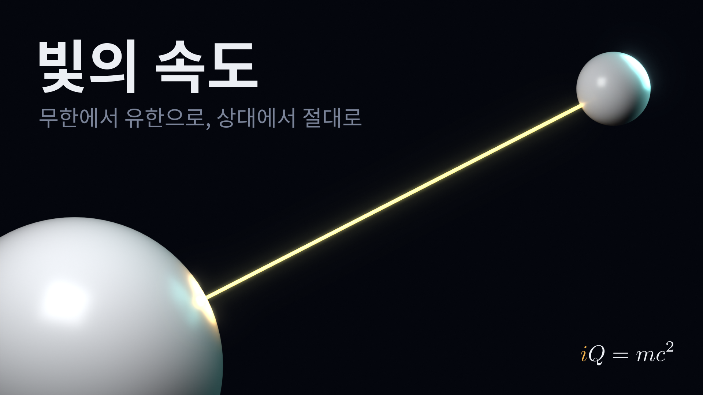
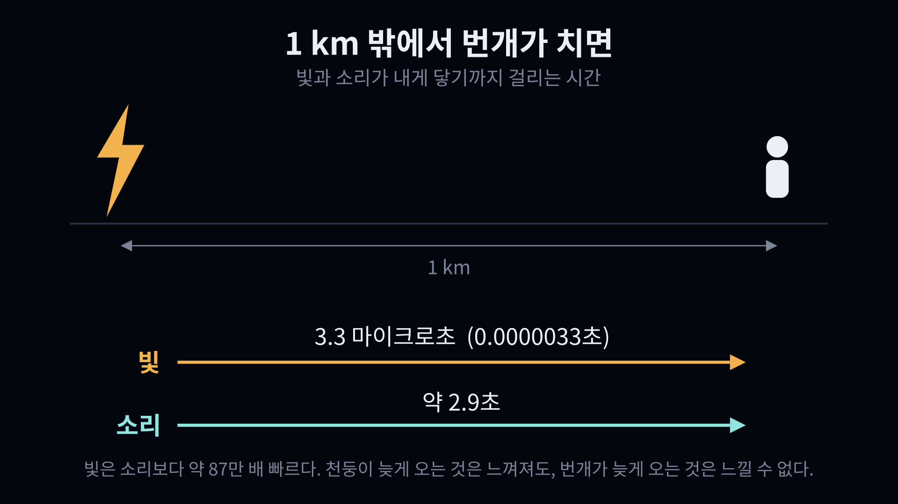
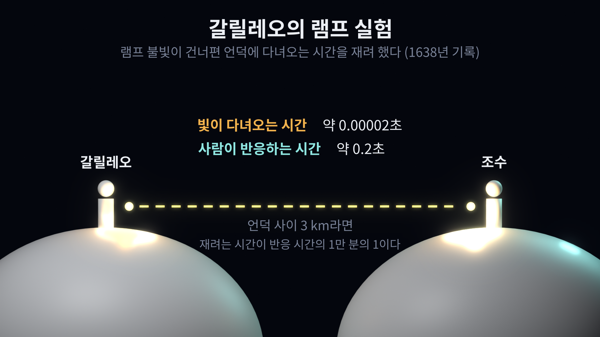
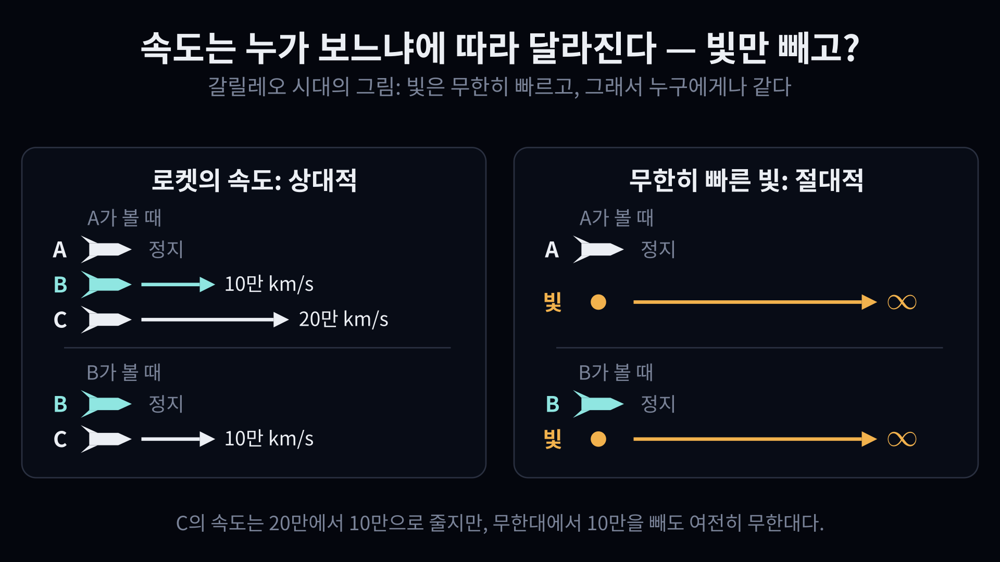
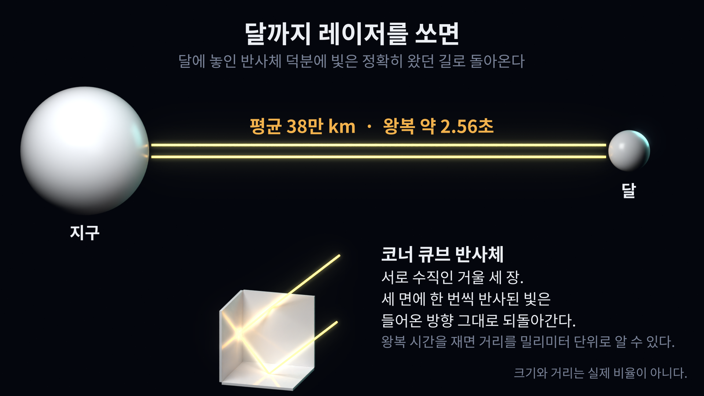
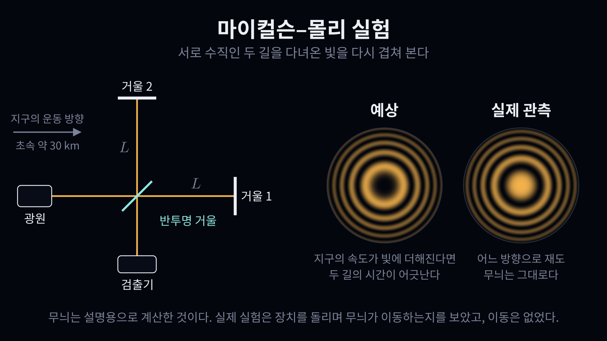
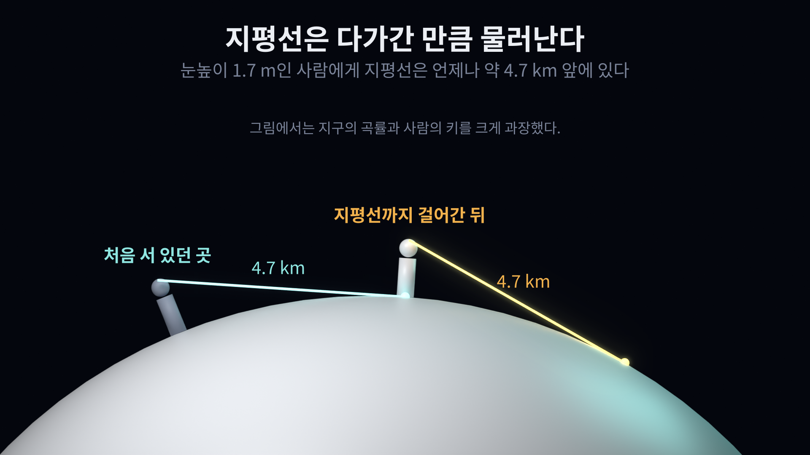
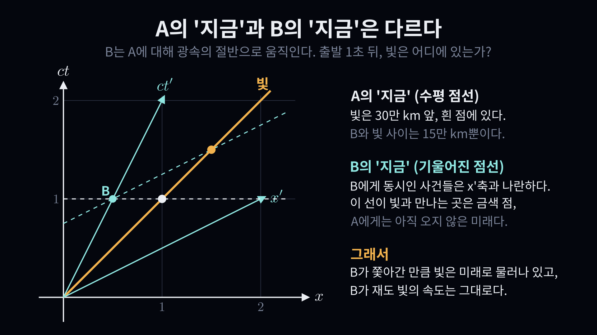
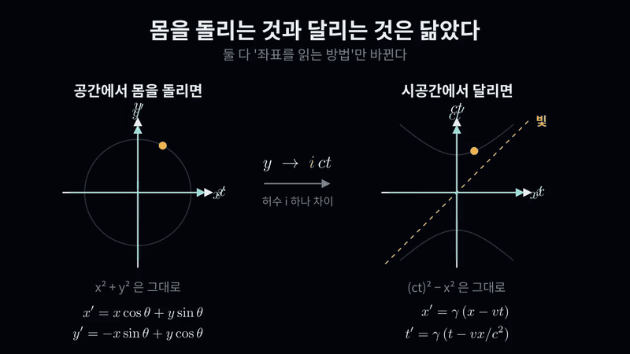
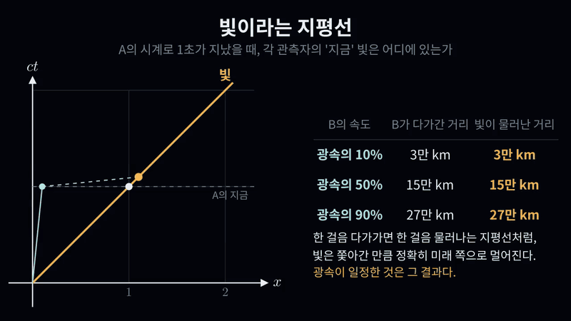

# 빛의 속도는 어떻게 '유한하면서 절대적'이 되었나

"빛의 속도로"라는 말은 물리학 용어 가운데 일상에서 가장 흔하게 쓰이는 말일 것이다. 그런데 이 말이 가리키는 대상은 지난 400년 동안 세 번 모습을 바꿨다. 무한하고 절대적인 것에서, 유한하고 상대적인 것으로, 다시 유한하면서 절대적인 것으로. 마지막 조합은 얼핏 모순처럼 들리는데, 그 모순을 푸는 과정에서 시간과 공간이라는 개념 자체가 고쳐졌다. 이 글은 그 변화를 차례로 따라간다.

## 1. 소리는 느껴지는데, 빛은 느껴지지 않는다

소리의 속도는 몸으로 느낄 수 있다. 텅 빈 강당에서 손뼉을 치면 벽에 맞고 돌아오는 소리가 조금 늦게 들리고, 산에서 외친 "야호"는 한참 뒤에 메아리로 돌아온다. 번개가 번쩍인 뒤 천둥이 들리기까지의 간격은 더 분명하다.

빛은 사정이 다르다. 1 km 밖의 번개에서 출발한 빛이 내 눈에 닿는 데는 약 3마이크로초가 걸린다. 스마트폰 화면을 켜든 경기장 조명을 켜든, 빛은 켜는 그 순간 보인다. 불을 처음 피운 사람들에게도, 물에 비친 제 모습을 본 사람들에게도 빛은 조금의 시차도 없이 공간을 채우는 존재였을 것이다. 빛은 무한히 빠르다고 생각하는 편이 자연스러웠다.

## 2. 갈릴레오의 램프 실험

빛이 정말 무한히 빠른지 실험으로 확인해 보려 한 사람이 갈릴레오다. 1638년에 펴낸 책에 그 방법이 적혀 있다. 두 사람이 덮개 달린 램프를 하나씩 들고 멀리 떨어져 선다. 한 사람이 덮개를 열면, 그 불빛을 본 다른 사람이 곧바로 자기 덮개를 연다. 첫 사람이 덮개를 연 순간부터 상대의 불빛을 보기까지 걸린 시간을 재면 빛이 왕복하는 데 걸린 시간을 알 수 있다는 생각이다.

결과는 "시차를 느낄 수 없었다"였다. 지금은 이유를 안다. 빛은 1초에 지구 지름의 23배가 넘는 거리를 간다. 두 사람이 3 km 떨어져 있었다 해도 빛이 다녀오는 데는 0.00002초면 충분하고, 이는 사람의 반응 시간 0.2초의 1만 분의 1이다. 손과 눈으로 잴 수 있는 시간이 아니었다. 갈릴레오 자신도 빛이 순간적이라고 단정하지는 않았고, 적어도 엄청나게 빠르다고만 결론지었다.

## 3. 무한히 빠르면 절대적이다

무한히 빠른 빛에는 한 가지 성질이 따라온다. 누가 보아도 속도가 같다는 것이다.

보통의 속도는 보는 사람에 따라 달라진다. 정지한 A가 볼 때 B가 초속 10만 km, C가 초속 20만 km로 같은 방향으로 날아간다면, B가 볼 때 C는 초속 10만 km로 멀어진다. 속도는 상대적이다.

하지만 켜는 순간 모든 공간을 채우는 빛이라면 이야기가 다르다. A가 보아도 무한대이고, 초속 10만 km로 쫓아가는 B가 보아도 무한대다. 무한대에서 무엇을 빼도 무한대이기 때문이다. 이런 뜻에서 무한한 빛의 속도는 관측자의 운동과 무관한, 절대적인 값이다.

## 4. 빛은 유한하다

물론 빛의 속도는 무한하지 않다. 갈릴레오의 실험 후 40년쯤 지난 1676년, 뢰머가 목성 위성의 식이 일어나는 시각이 지구와 목성 사이 거리에 따라 달라진다는 것을 근거로 빛이 유한한 속도로 전달된다는 사실을 처음 보였다.

오늘날에는 이 유한한 속도를 자로 쓴다. 미국 뉴멕시코주의 아파치 포인트 천문대는 달 표면의 반사체를 향해 레이저를 쏘고, 그 빛이 돌아오기까지 걸린 시간을 잰다. 반사체 가운데 하나는 1969년 아폴로 11호가 두고 온 것이다.

이 반사체는 서로 수직인 거울 세 장을 모서리처럼 맞붙인 구조다. 여기에 들어온 빛은 세 면에 한 번씩 반사된 뒤 들어온 방향 그대로 되돌아간다. 지구에서 쏜 빛은 약 2.56초 뒤에 제자리로 돌아오고, 이 시간에서 지구와 달 사이의 거리를 밀리미터 단위로 알아낸다.

빛의 속도가 유한하다면, 3절의 그림은 다시 그려야 한다. 유한한 속도는 상대적이어야 하기 때문이다. 빛을 쫓아 달리는 사람에게는 빛이 그만큼 느리게 보여야 마땅하다.

## 5. 마이컬슨과 몰리: 그런데 느려지지 않는다

과학자들은 이 예상을 실험으로 확인하려 했다. 가장 유명한 것이 1887년 마이컬슨과 몰리의 실험이다.

간섭계는 빛 한 줄기를 둘로 나누어 서로 수직인 두 길로 보낸 다음, 거울에 반사되어 돌아온 두 빛을 다시 겹친다. 두 빛이 돌아오는 데 걸린 시간이 조금이라도 다르면 겹쳐진 무늬가 달라진다.

지구는 태양 둘레를 초속 약 30 km로 돈다. 빛의 속도가 상대적이라면, 지구가 움직이는 방향으로 다녀온 빛과 그에 수직인 방향으로 다녀온 빛은 걸리는 시간이 달라야 한다. 장치를 돌려 방향을 바꾸면 무늬가 이동해야 한다. 그런데 무늬는 움직이지 않았다. 어느 방향으로 재도 빛은 같은 속도로 다녀왔다.

(위 그림의 두 무늬는 "시간이 어긋난 경우"와 "어긋나지 않은 경우"의 차이를 보이려고 계산한 것이다. 실제 실험이 찾으려던 것은 장치를 돌릴 때 생기는 무늬의 미세한 이동이었고, 예상된 크기의 이동은 관측되지 않았다.)

정리하면 이렇다.

빛의 속도는 유한하다. 그런데 관측자가 어떻게 움직이든 같은 값으로 측정된다. 유한하면서 절대적이다. 당시의 물리학, 곧 뉴턴 역학으로는 설명할 수 없는 결과였다.

## 6. 의심받지 않던 것: 시간과 공간

해답이 쉽게 나오지 않은 까닭은, 고쳐야 할 곳이 너무 기초적인 데 있었기 때문이다. 속도는 거리를 시간으로 나눈 것이다. 속도에 관한 결과가 이상하다면 의심할 대상은 거리와 시간, 곧 공간과 시간이다.

하지만 시간과 공간은 물리학에서 가장 먼저 등장하는 개념이다. 물리 법칙에 법전이 있다면 헌법 1조 1항에 해당한다. 이것을 고치면 속도, 운동량, 에너지 같은 거의 모든 개념을 다시 정의해야 한다. 1905년, 스위스 베른의 특허청에서 일하던 스물여섯 살의 아인슈타인이 바로 그 일을 했다. 특수 상대성 이론이다.

## 7. 유한하면서 절대적인 것: 지평선

유한하면서도 절대적인 것의 예는 우리 주변에 이미 있다. 지평선이다.

평지에 선 사람에게 지평선은 약 4.7 km 앞에 있다. 분명히 유한한 거리다. 그런데 그곳까지 걸어가 보면, 지평선은 다시 4.7 km 앞에 있다. 한 걸음 다가가면 한 걸음 물러난다. 지구 위 어디에 서든 지평선까지의 거리는 같다. 지구가 둥글기 때문에 생기는 일이다.

빛의 속도가 절대적인 방식도 이와 닮았다. 다만 빛이 물러나는 방향이 공간이 아니라 시간 쪽이다.

## 8. '지금'은 사람마다 다르다

이것을 보려면 공간과 시간을 한 장에 그려야 한다. 가로축은 위치, 세로축은 시간이다. 세로축에는 시간에 광속을 곱한 값을 써서, 빛이 45도 직선으로 그려지게 한다.

A는 정지해 있고, B는 A에 대해 광속의 절반으로 움직인다. 둘이 같은 곳에 있던 순간 빛이 출발했다. A의 시계로 1초 뒤, A는 이렇게 말한다. "지금 빛은 30만 km 앞에 있고, B는 15만 km 앞에 있다. 둘 사이는 15만 km다." 우리의 직관은 여기서 B도 같은 말을 하리라고 기대한다. B에게 빛은 초속 15만 km로 멀어져야 한다고.

그런데 이 기대에는 A의 '지금'과 B의 '지금'이 같다는 가정이 숨어 있다. 특수 상대성 이론이 밝힌 것은 그 가정이 틀렸다는 사실이다. A에게 동시인 사건들은 수평선 위에 놓이지만, 움직이는 B에게 동시인 사건들은 기울어진 선 위에 놓인다. B의 '지금'을 따라가 보면, 빛은 A가 말한 자리(흰 점)가 아니라 그보다 앞선 자리(금색 점)에 있다. A에게는 아직 일어나지 않은 미래의 사건이, B에게는 지금이다.

## 9. 달리는 것은 회전하는 것이다

내가 움직이기 시작하면 우주 전체의 시공간이 그에 맞춰 바뀌는 걸까? 그렇지 않다. 바뀌는 것은 내가 좌표를 읽는 방법뿐이다.

창밖의 다리를 바라본다고 하자. 나는 내 앞쪽과 옆쪽을 기준으로 다리의 위치를 두 숫자로 적을 수 있다. 내가 몸을 돌리면 그 숫자들은 바뀐다. 하지만 다리가 움직인 것은 아니다. 내 좌표축이 돌았을 뿐이다. 그리고 숫자가 어떻게 바뀌든 나와 다리 사이의 거리, 곧 x² + y²은 그대로다.

아인슈타인이 밝힌 것은, 일정한 속도로 달리는 일이 시공간에서의 회전에 해당한다는 사실이다. 달리는 관측자의 시간축은 기울고, 공간축도 같은 각도만큼 기운다. 두 축은 빛의 선을 향해 가위처럼 접힌다. 이 변환을 로런츠 변환이라 부른다. 여기서도 변하지 않는 양이 있는데, 이번에는 (ct)² − x²이다.

두 식은 놀랄 만큼 닮았다. 회전 공식의 y 자리에 시간을 넣되 허수 i를 곱해서 넣으면, 곧 y 대신 i·ct를 쓰면 로런츠 변환이 나온다. x² + y²이 x² − (ct)²으로 바뀌는 것도 i² = −1 때문이다. 시간은 공간과 같은 자격으로 회전에 참여하지만, 부호 하나만큼 다르다.

## 10. 빛이라는 지평선

이제 8절의 그림을 여러 속도로 다시 그려 보자.

A의 시계로 1초 동안 B가 광속의 10%로 달렸다면, B는 빛 쪽으로 3만 km 다가갔다. 그런데 B의 '지금'에서 빛은 3만 km만큼 더 먼 곳에 있다. 광속의 50%로 달렸다면 15만 km, 90%로 달렸다면 27만 km다. B가 다가간 만큼, 빛은 정확히 그만큼 미래 쪽으로 물러나 있다.

지평선까지의 거리는 하나의 정해진 값이지만, 그 값은 내가 걸을 때마다 지평선이 물러남으로써 유지된다. 빛의 속도도 하나의 정해진 값이지만, 그 값은 관측자가 달릴 때마다 빛이 시공간에서 물러남으로써 유지된다. 지구가 둥글어서 지평선이 있듯이, 시공간의 구조가 우리가 알던 공간과 근본적으로 달라서 빛의 속도라는 지평선이 있다.

## 맺으며: 시간 앞의 허수

빛의 속도는 무한하면서 절대적인 값에서, 유한하면서 상대적인 값으로, 다시 유한하면서 절대적인 값으로 바뀌어 왔다. 마지막 변화는 빛에 대한 생각을 고친 것이 아니라 시간과 공간에 대한 생각을 고친 것이었다.

한 가지 흥미로운 점을 덧붙인다. 9절에서 회전 공식의 한 축에 i·ct를 넣는 것만으로 로런츠 변환이 나왔다. 특수 상대성 이론의 거의 모든 결과가 이 변환에서 나오니, 시간 앞에 허수 하나를 붙인 것이 이론 전체를 불러낸 셈이다. 오늘날의 교과서는 허수를 쓰는 대신 부호를 따로 챙기는 방식을 주로 쓰지만, 담긴 내용은 같다. 그리고 양자역학의 기본 방정식에서도 시간은 허수 i와 함께 등장한다. 우연인지 아닌지는 다음 글에서 살펴보려 한다.

---

*그림은 모두 코드로 만들었다. 소스: <https://github.com/see-why-lab/iQmc2-speed-of-light>*
